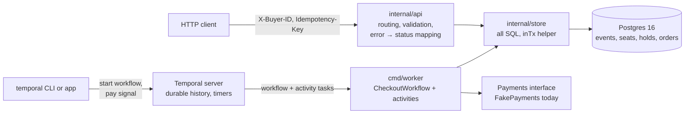
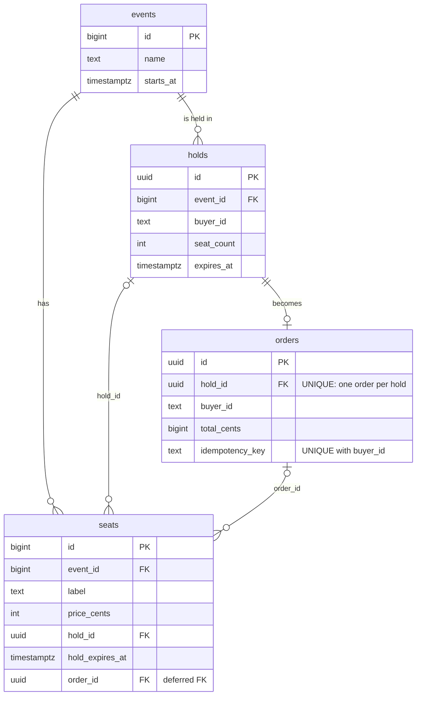
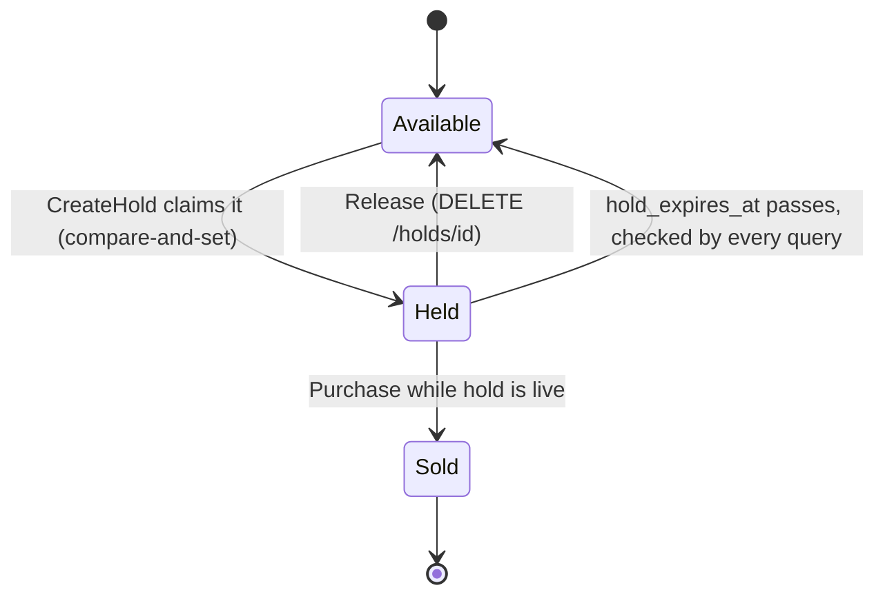
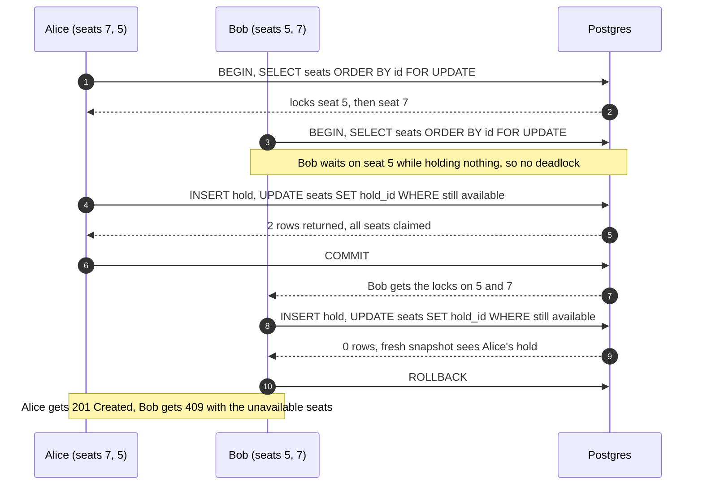
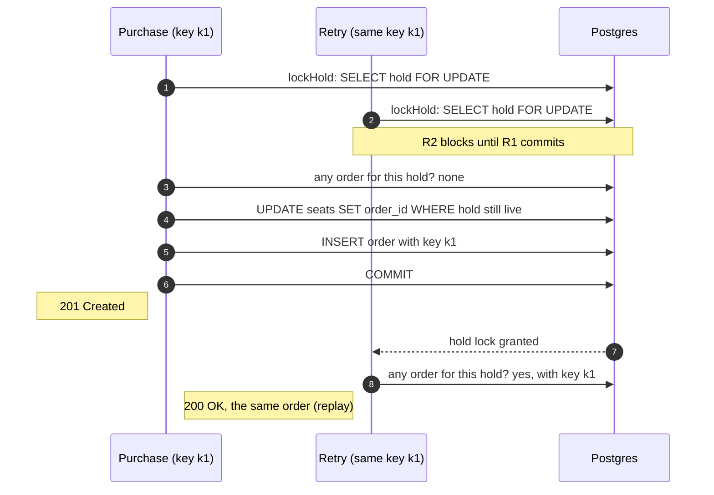
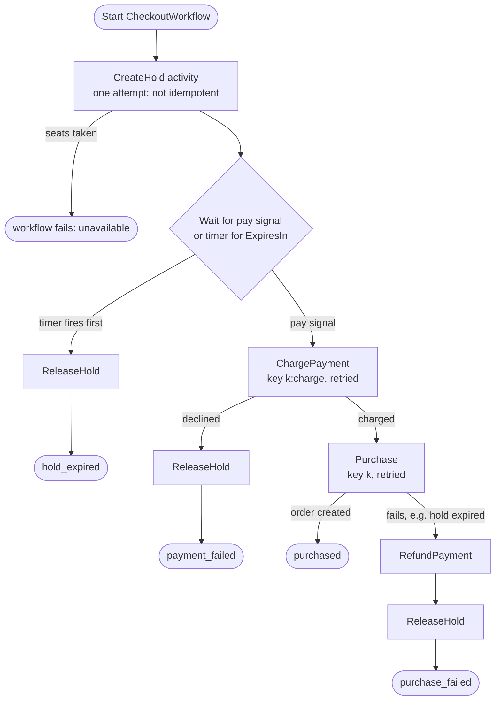

# System diagrams

Mermaid diagrams of the service; GitHub renders them inline. Each one ends with a one-line summary.

## System overview

There are two ways in. The HTTP API (`cmd/server`) handles holds and purchases directly. The Temporal worker (`cmd/worker`) runs the same store code as a durable checkout workflow. Everything that touches seat state goes through `internal/store`, and Postgres decides every race.

> All SQL lives in the store package, and every seat change is a single conditional UPDATE, so the database decides who wins. Temporal adds durable orchestration on top: waiting, retries and compensation.

## Data model

Each seat is its own row, so one row is the unit of contention. A seat is available when `order_id IS NULL AND (hold_id IS NULL OR hold_expires_at <= now())`. `orders.hold_id` is unique (one order per hold), and `(buyer_id, idempotency_key)` is unique (one hold per key). `seats.order_id` is a deferred foreign key, so a purchase can mark seats sold before inserting the order, in one transaction.

> The state lives on the seat row, so contention is per seat, not per event.

## Seat lifecycle

There is no background job for expiry. An expired hold simply stops matching the held condition, and the next CreateHold can claim the seat. Release frees seats right away. Purchase only succeeds while the hold is still live.

> Expiry is checked lazily against the database clock, so there is no sweeper to fall behind or crash.

## Two buyers race for overlapping seats (CreateHold)

Both buyers lock seats in ascending id order with `SELECT … ORDER BY id FOR UPDATE`, so the second waits without holding anything and no deadlock can form. The conditional UPDATE then decides the winner: it sees a fresh snapshot and returns fewer rows than requested if anyone else got there first. Sorting the ids in Go does not set the lock order; only the SQL `ORDER BY` does.

> Deadlocks need a cycle. If every transaction locks in the same order, a cycle can’t form.

## A retried purchase gets the same order (idempotency)

Purchase reads before it writes: it checks whether this hold already has an order. Locking the hold row first makes concurrent requests take turns, so a retry sees the committed order and replays it (200) instead of failing with “seats lost”. With that lock removed, the concurrency test fails 9 times out of 10.

> The seat UPDATE keeps it correct. The hold lock keeps retries idempotent.

## Checkout workflow in Temporal (saga)

The workflow waits durably for payment or expiry. The timer runs for a duration Postgres computed, so the two clocks are never compared. Each failure undoes earlier steps in reverse. Transient errors retry with backoff, and business errors (declined card, expired hold) do not. Every retried step is idempotent. CreateHold isn’t, so it gets one attempt.

> If the charge succeeds but the purchase fails, we refund, then release. Retries are safe because every step that can repeat is keyed.
